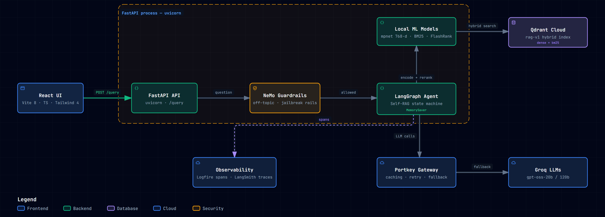
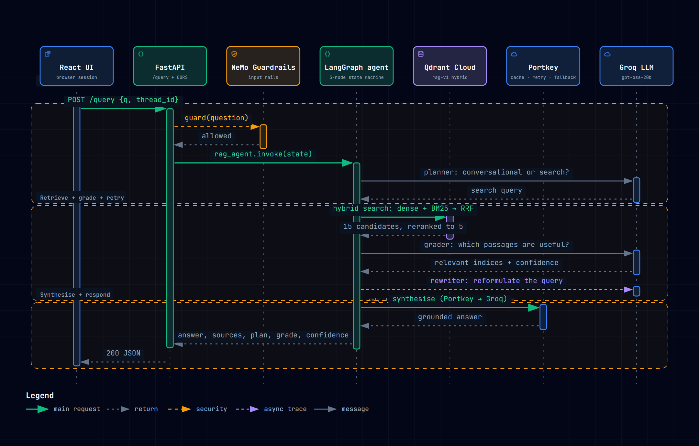
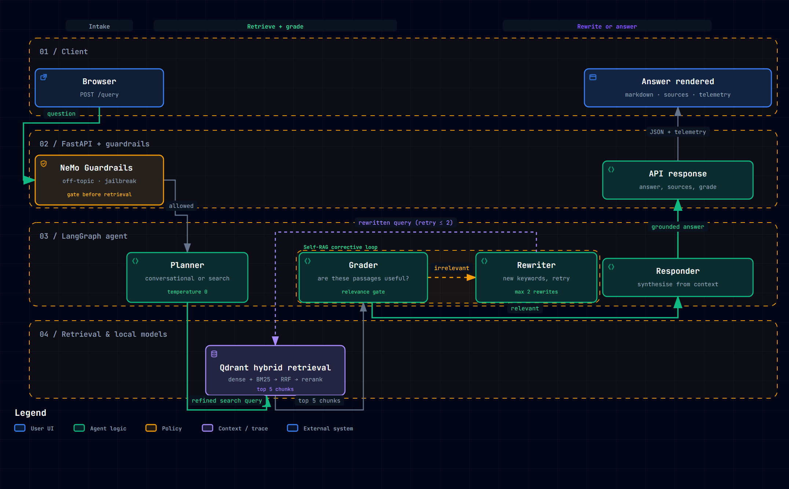
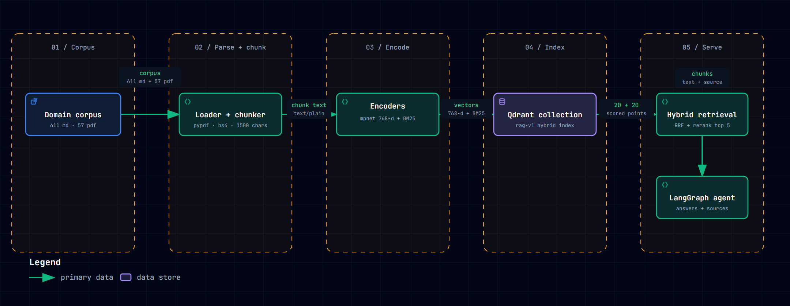

# Advanced RAG — Agentic Retrieval with Self-RAG Correction

**A production-shaped RAG service, not a demo notebook.** FastAPI + LangGraph orchestrates a five-node agent that plans, retrieves with hybrid search, grades its own context, rewrites the query when the evidence is weak, and answers with cited sources — behind NeMo Guardrails, through an LLM gateway, with two independent evaluation suites gating CI.

<p>
  
  
  
  
  
  
</p>

---

## Table of contents

- [About](#about)
- [System architecture](#system-architecture)
- [Request lifecycle](#request-lifecycle)
- [The Self-RAG corrective loop](#the-self-rag-corrective-loop)
- [Ingestion pipeline](#ingestion-pipeline)
- [Why this is more than a vector-search wrapper](#why-this-is-more-than-a-vector-search-wrapper)
- [Quick start](#quick-start)
- [Installation](#installation)
- [Configuration](#configuration)
- [API](#api)
- [Retrieval parameters](#retrieval-parameters)
- [Stack](#stack)
- [Evaluation & CI](#evaluation--ci)
- [Repository layout](#repository-layout)
- [Diagram generation](#diagram-generation)
- [Known limitations](#known-limitations)
- [Roadmap](#roadmap)
- [Contributing](#contributing)
- [FAQ](#faq)
- [Credits](#credits)
- [License](#license)

---

## About

Advanced RAG answers questions over a 674-document technical corpus (13 domains) and shows its work: the plan it followed, the passages it retrieved, the grade it gave its own context, and the number of rewrites it needed. It exists to demonstrate the parts that separate a working RAG product from a vector-store demo — hybrid retrieval, reranking, self-correction, guardrails, provider failover, and measured quality.

| | |
|---|---|
| **Answer pipeline** | planner → retriever → grader → rewriter → responder (LangGraph, checkpointed per `thread_id`) |
| **Retrieval** | Hybrid dense (`all-mpnet-base-v2`, 768-d) + BM25 sparse → Reciprocal Rank Fusion → FlashRank cross-encoder rerank |
| **Corrective loop** | Self-RAG grading with a bounded rewrite budget (`MAX_RETRIEVAL_RETRIES = 2`) |
| **Index** | Qdrant collection `rag-v1`: **1174 points** across **674 source documents**, 13 technical domains |
| **Quality gates** | RAGAS + DeepEval suites with thresholds, 16 offline unit tests, GitHub Actions |
| **Observability** | Logfire spans + LangSmith traces; Self-RAG telemetry returned on every response |

---

## System architecture

<p align="center">
  
</p>

<sub>PNG preview · [vector SVG](docs/diagrams/architecture.svg)</sub>

A request enters FastAPI, passes the guardrail gate, and is executed by the LangGraph agent inside the same process. Retrieval and reranking run against local models plus the Qdrant Cloud index; synthesis goes out through the Portkey gateway to Groq.

---

## Request lifecycle

<p align="center">
  
</p>

<sub>PNG preview · [vector SVG](docs/diagrams/request-lifecycle.svg)</sub>

One `POST /query`, end to end: guardrail gate → planner → hybrid search → RRF fusion → cross-encoder rerank → relevance grading → (optional bounded rewrite) → synthesised answer with sources, plan steps and telemetry.

---

## The Self-RAG corrective loop

<p align="center">
  
</p>

<sub>PNG preview · [vector SVG](docs/diagrams/self-rag-loop.svg)</sub>

- The **planner** decides between a conversational answer (memory only) and a documentation search at `temperature = 0`.
- The **grader** reads each retrieved passage against the question and returns the useful indices plus a confidence score.
- An **irrelevant** verdict routes to the **rewriter**, which produces a new query; `retry_count` bounds the loop at two attempts.
- A **vector-store outage** takes the short path: no grading, no rewrites, disclosed in the answer — because reformulating a query cannot fix a dead connection.

---

## Ingestion pipeline

<p align="center">
  
</p>

<sub>PNG preview · [vector SVG](docs/diagrams/ingestion-pipeline.svg)</sub>

Documents are parsed locally (pypdf, BeautifulSoup, python-pptx/docx), split into ~1500-character paragraph chunks, encoded both densely (`all-mpnet-base-v2`) and sparsely (`Qdrant/bm25` via fastembed), and written to Qdrant in one upsert per file. Chunk metadata is also archived to `processed_data/<domain>/` as JSON, so the corpus is inspectable without touching the vector database.

```bash
# wipe + rebuild the hybrid collection from a corpus folder
python -m app.Ingestion.processor data/true_data --wipe
```

---

## Why this is more than a vector-search wrapper

- **Hybrid retrieval, not vector-only.** Every Qdrant point carries a 768-dimensional dense vector *and* a BM25 sparse vector, so paraphrase and exact identifiers (acronyms, error strings, API names) both score. The two rankings are fused with **Reciprocal Rank Fusion** — no hand-tuned weights.
- **A cross-encoder decides what the LLM sees.** The fused list is reranked by a local FlashRank ONNX cross-encoder, then a **relevance grader** accepts or rejects each passage before synthesis. The model never sees context a grader rejected.
- **The agent corrects itself.** On an irrelevant verdict, a rewriter reformulates the query and retrieval re-runs — bounded at two attempts so the loop always terminates and the last context is still usable.
- **Guardrails sit before the expensive work.** NeMo Guardrails handles greetings, off-topic questions and jailbreak attempts before retrieval, planning, or spend.
- **Provider failures are absorbed.** Synthesis runs through Portkey with fallback targets, response caching and retries on 429/503, so a single provider blip doesn't surface as an error.
- **Failures are reported honestly.** An unreachable vector store raises `RetrievalUnavailableError` instead of quietly returning zero results: grading and rewriting are skipped, the answer discloses that retrieval failed, and the UI shows *"Retrieval unavailable"* rather than blaming the query with *"0% confidence"*.
- **Quality is measured, not assumed.** RAGAS and DeepEval score faithfulness, relevancy, context precision/recall, hallucination and scope adherence; breaching a threshold in `evals/thresholds.py` fails the build.

### Features

- ✨ **Five-node agent graph** — planner, retriever, grader, rewriter and responder, checkpointed per conversation thread.
- 🔍 **Hybrid search + rerank** — dense embeddings, BM25 sparse vectors, RRF fusion, FlashRank cross-encoder.
- 🔁 **Bounded self-correction** — the grader can reject context and trigger at most two rewrites.
- 🛡️ **Guardrails first** — NeMo Guardrails blocks off-topic, jailbreak and greeting traffic before any spend.
- 📊 **Telemetry on every answer** — grade, confidence, retry count, retrieval error and the full plan.
- ⚡ **Resilient synthesis** — Portkey gateway with caching, retries and fallback providers.
- 🧪 **Two independent judges** — RAGAS and DeepEval gates in CI, plus 16 offline unit tests.
- 🖥️ **React client** — reasoning timeline, source chunks, latency and rewrite chips, live backend status.

---

## Quick start

```bash
# 1. Clone
git clone https://github.com/Anshika102005/Enterprise-Grade-RAG-Application.git
cd Enterprise-Grade-RAG-Application

# 2. Install
python -m venv .venv && source .venv/Scripts/activate    # Windows
# source .venv/bin/activate                              # macOS / Linux
pip install -r requirement.txt

# 3. Configure — create .env with the keys from the Configuration table
#    Minimum: QDRANT_CLUSTER_ENDPOINT, QDRANT_API_KEY, GROQ_API_KEY, PORTKEY_API_KEY

# 4. Ingest a corpus (first run creates the hybrid collection)
python -m app.Ingestion.processor data/true_data --wipe

# 5. Run the API
uvicorn app.main:app --reload --port 8000                 # Swagger at /docs

# 6. Run the UI
cd frontend && npm install && npm run dev                 # http://localhost:5173
```

The dev server proxies `/api/*` to `http://localhost:8000`, so there is no CORS friction locally.

---

## Installation

### Prerequisites

| Tool | Version | Notes |
|---|---|---|
| Python | 3.12+ | virtualenv recommended |
| Node.js | 20+ | only for the React client |
| Qdrant | Cloud cluster or local | named dense + sparse vectors required |
| Groq API key | — | planner, grader, rewriter, responder |
| Portkey API key | — | synthesis gateway |
| Google Chrome | any recent | optional, only for diagram re-export |

The embedding and reranking models (`all-mpnet-base-v2`, FlashRank MiniLM) run on CPU and are downloaded on first use; no GPU is required.

### Manual setup

```bash
python -m venv .venv
source .venv/Scripts/activate        # Windows
# source .venv/bin/activate          # macOS / Linux
pip install -r requirement.txt
# create .env in the project root with the variables listed below
```

---

## Configuration

All settings are read from `.env` through `app/config.py`.

| Variable | Required | Purpose |
|---|---|---|
| `QDRANT_CLUSTER_ENDPOINT` | ✅ | Qdrant Cloud cluster URL |
| `QDRANT_API_KEY` | ✅ | Qdrant API key |
| `GROQ_API_KEY` | ✅ | planner / grader / rewriter model calls |
| `PORTKEY_API_KEY` | ✅ | synthesis gateway (fallback, cache, retries) |
| `GROQ_FALLBACK_API_KEY` | – | secondary provider key for the gateway |
| `JUDGE_GROQ` | – | dedicated eval budget; falls back to `GROQ_API_KEY` |
| `LOGFIRE_TOKEN` | – | span export to Logfire |
| `LANGSMITH_API_KEY` | – | LangGraph tracing |
| `HUGGINGFACE_EMBEDDING_MODEL` | – | override the dense encoder |
| `CORS_ORIGINS` | – | comma-separated allowed origins for the SPA |

Never commit `.env`; it is excluded by `.gitignore`.

---

## API

| Method | Path | Description |
|---|---|---|
| `GET` | `/` | service banner and index info |
| `GET` | `/graph` | Mermaid/JSON view of the agent graph |
| `POST` | `/query` | run the agent for a question and `thread_id` |
| `GET` | `/docs` | interactive OpenAPI documentation |

`POST /query`

```json
{ "q": "What is a database? Types and use cases for relational and NoSQL systems.",
  "thread_id": "user-42" }
```

```json
{
  "answer": "…",
  "thought_process": ["Intent: Technical", "Search Term: …", "Context Retrieved (attempt 1)",
                      "Grade: relevant (2 passages, conf 0.80)"],
  "status": "Response generated.",
  "sources": ["CONTENT: # NoSQL databases …", "CONTENT: # relational database fundamentals …"],
  "retrieval_grade": "relevant",
  "retrieval_confidence": 0.8,
  "retrieval_retries": 0,
  "retrieval_error": null
}
```

Telemetry is first-class: `retrieval_grade` (`relevant` · `irrelevant` · `unavailable`), `retrieval_confidence`, `retrieval_retries`, and `retrieval_error` — non-null only when the vector store itself was unreachable. The UI renders that as a distinct *"Retrieval unavailable"* state, so an infrastructure failure is never presented as a relevance verdict.

```bash
curl -s http://localhost:8000/query \
  -H "Content-Type: application/json" \
  -d '{"q":"Explain reciprocal rank fusion","thread_id":"demo"}'
```

---

## Retrieval parameters

All tunable without code changes (`app/config.py`, environment overrides):

| Setting | Default | Role |
|---|---|---|
| `RETRIEVAL_DENSE_TOP_K` | 20 | dense candidates |
| `RETRIEVAL_SPARSE_TOP_K` | 20 | BM25 candidates |
| `RETRIEVAL_FUSED_TOP_K` | 15 | candidates kept after RRF |
| `RRF_K` | 60 | Reciprocal Rank Fusion constant |
| `RERANK_TOP_N` | 5 | chunks passed to the grader/responder |
| `MAX_RETRIEVAL_RETRIES` | 2 | bounded rewrite attempts |

Dense encoder `sentence-transformers/all-mpnet-base-v2` (768-d, cosine) · sparse encoder `Qdrant/bm25` · reranker FlashRank `ms-marco-MiniLM-L-6-v2` (local ONNX) · reasoning model `openai/gpt-oss-20b` on Groq.

---

## Stack

| Layer | Choice | Why it's there |
|---|---|---|
| API | FastAPI + uvicorn | async `/query`, `/docs`, `/graph`, CORS for the SPA |
| Orchestration | LangGraph + MemorySaver | cyclic agent graph with per-thread memory and a bounded corrective loop |
| Vector store | Qdrant Cloud (named dense + sparse vectors) | hybrid search and payload filtering in one collection |
| Retrieval models | sentence-transformers, fastembed, FlashRank | local encode + local rerank, so only synthesis costs an API call |
| LLM | Groq (`openai/gpt-oss-20b`) | fast grader/rewriter/planner calls |
| Gateway | Portkey | fallback targets, caching, retries, unified observability |
| Guardrails | NVIDIA NeMo Guardrails | off-topic, jailbreak and dialog rails before retrieval |
| Observability | Pydantic Logfire + LangSmith | span-level traces from API to vector search |
| Evaluation | RAGAS + DeepEval + pytest | two independent judges and offline unit tests in CI |
| Frontend | React 19 · Vite 8 · TypeScript · Tailwind v4 | chat UI with reasoning timeline, sources and telemetry |

---

## Evaluation & CI

Two independent judges over the same pipeline, so scores are not one vendor's opinion:

| Suite | Metrics | Notes |
|---|---|---|
| **RAGAS** | faithfulness, answer_relevancy, context_precision, context_recall | retrieval + grounding quality |
| **DeepEval** | faithfulness, hallucination, answer_correctness, scope_adherence | grounding, correctness, guardrail scope |

Thresholds live in [`evals/thresholds.py`](evals/thresholds.py) (for example faithfulness ≥ 0.80, context_recall ≥ 0.75, hallucination ≤ 0.30) and the runners **exit non-zero** when a metric breaches its gate, so they work directly as CI checks. See [`evals/README.md`](evals/README.md) for metric definitions and the golden dataset format.

```bash
python -m evals.run_ragas    --record evals/fixtures/samples.json   # call backend + score
python -m evals.run_deepeval --samples evals/fixtures/samples.json  # re-score, no Qdrant needed
pytest -q                                                           # 16 offline unit tests
```

`.github/workflows/rag-eval.yml` runs the offline unit tests on every push and PR, and runs the RAGAS + DeepEval gates when a deployed backend and judge key are configured — plus a weekly regression sweep.

---

## Repository layout

```
app/
├── main.py                     FastAPI app: guardrails gate → LangGraph → response payload
├── config.py                   settings, retrieval tunables, gateway/eval keys
├── agents/
│   ├── graph.py                5-node StateGraph, checkpointed per thread_id
│   ├── state.py                AgentState (documents, plan, grade, confidence, retrieval_error)
│   └── nodes/                  planner · retriever · grader · rewriter · responder
├── services/Retrieval/
│   ├── qdrant_service.py       hybrid search, RRF fusion, legacy fallback, outage signalling
│   ├── embeddings.py           all-mpnet-base-v2 (768-d)
│   ├── ranking_service.py      FlashRank cross-encoder reranking
│   └── fusion.py · schema.py   RRF + named-vector contract
├── Ingestion/                  loaders (pdf/html/text/office) · chunker · processor CLI
└── guardrails/                 Colang intents/flows + LLMRails wiring
evals/                          RAGAS + DeepEval runners, golden dataset, thresholds
frontend/                       React UI (see frontend/README.md)
tests/                          offline unit tests (RRF fusion, grader parsing)
docs/diagrams/                  SVG sources and 2× PNG previews used by this README
.archify/                       archify build workspace (git-ignored): specs + interactive HTML
```

---

## Diagram generation

Every diagram above is generated from a typed JSON specification with the [archify](https://github.com/tt-a1i/archify) skill — no hand-drawn boxes. They share a single dark technical palette (`#020617` canvas, teal processing, violet storage, blue external services, amber boundaries, `#8B5CF6` agent accents) defined once in `_diagram_theme.py`, so every export stays consistent.

| Diagram | Type | Build folder |
|---|---|---|
| System architecture | architecture | `.archify/architecture-rag-system-20261028-021934/` |
| Request lifecycle | sequence | `.archify/sequence-request-lifecycle-20261028-022800/` |
| Self-RAG corrective loop | workflow | `.archify/workflow-self-rag-loop-20261028-022233/` |
| Ingestion pipeline | dataflow | `.archify/dataflow-ingestion-pipeline-20261028-023107/` |

```bash
# re-export all four SVGs and 2× PNGs (requires the .archify workspace + Chrome)
python _export_diagrams.py
```

The exporter embeds explicit colours and the bundled font in each SVG, validates it as XML, and renders the PNG from that SVG at 2× — the exported files do not depend on any external stylesheet.

---

## Known limitations

Deliberately documented rather than hidden:

- **Guardrail scope is narrower than the corpus.** `app/guardrails/colang_rules.py` still describes an enterprise-IT assistant (Kubernetes / Intel / networking), while the indexed corpus spans 13 domains; broaden the Colang intents before exposing the API publicly. The evaluation suite's `scope_adherence` metric tracks the same boundary.
- **Ingestion is not idempotent.** Point IDs are random UUIDs and content is not hashed, so re-running a folder without `--wipe` duplicates its chunks.
- **No payload index on `source_type`.** Filtered counts/searches return HTTP 400 until one is created; the current pipeline filters nothing.
- **The vector store is a hard dependency for grounded answers.** Outages are now surfaced (see `retrieval_error`) rather than silently degrading, but the service still answers from model knowledge in that state.
- **A legacy `enterprise_rag` collection** (single unnamed 768-d vector, pre-hybrid schema) remains in the cluster; nothing in the code points at it.
- **Logfire's console exporter** raises a `UnicodeEncodeError` on Windows `cp1252` terminals and prints stack traces into the server log; run with `PYTHONIOENCODING=utf-8` for clean output.

---

## Roadmap

- [x] Hybrid retrieval with RRF fusion and cross-encoder reranking
- [x] Self-RAG grading with a bounded rewrite loop
- [x] Guardrails gate and Portkey failover
- [x] React client with reasoning timeline and telemetry
- [x] RAGAS + DeepEval gates in CI
- [ ] Broaden Colang intents to all 13 corpus domains
- [ ] Idempotent ingestion via content hashing
- [ ] `source_type` payload index
- [ ] Docker Compose for API + UI
- [ ] Public demo and UI screenshots

---

## Contributing

1. Fork the repository and create a feature branch (`git checkout -b feature/my-change`).
2. Keep the offline tests green: `pytest -q`.
3. Re-export diagrams if you change the architecture: `python _export_diagrams.py`.
4. Open a pull request describing the behaviour changed and how you verified it.

---

## FAQ

**Does this need a GPU?**
No. Embeddings and reranking run on CPU; only planner/grader/rewriter/synthesis calls leave the machine.

**Can I run it without Qdrant Cloud?**
Yes — point `QDRANT_CLUSTER_ENDPOINT` at a local Qdrant instance. The collection must support the named dense + sparse vector schema.

**How do I add documents?**
Drop them in a corpus folder and run `python -m app.Ingestion.processor <folder> --wipe`. Loaders support PDF, HTML, plain text and Office formats.

**Why did my first query take so long?**
The dense encoder and FlashRank reranker download and warm up on first use.

**Why does the server log show Unicode errors on Windows?**
Logfire's console exporter cannot write to `cp1252`; run with `PYTHONIOENCODING=utf-8`.

---

## Credits

- Diagrams generated with [archify](https://github.com/tt-a1i/archify).
- Built on [FastAPI](https://fastapi.tiangolo.com), [LangGraph](https://langchain-ai.github.io/langgraph/), [Qdrant](https://qdrant.tech), [Groq](https://groq.com), [Portkey](https://portkey.ai), [NeMo Guardrails](https://github.com/NVIDIA/NeMo-Guardrails), [RAGAS](https://docs.ragas.io) and [DeepEval](https://docs.confident-ai.com).
- Frontend built with [React](https://react.dev), [Vite](https://vite.dev) and [Tailwind CSS](https://tailwindcss.com).

---

## License

No license file is currently included in this repository, so all rights are reserved by default. Add a `LICENSE` file (for example MIT or Apache-2.0) before redistributing or accepting external contributions.
